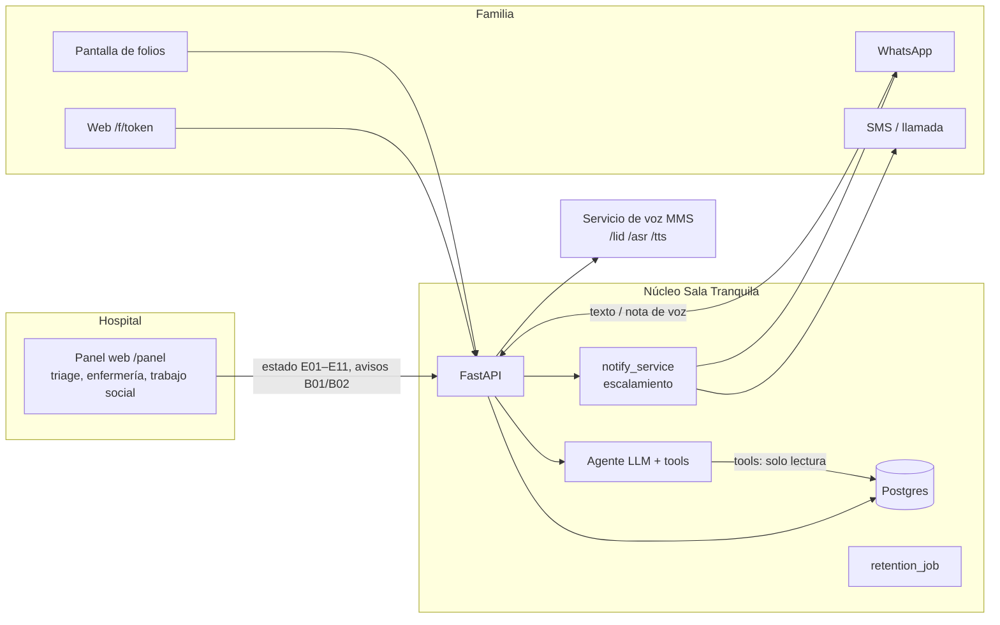
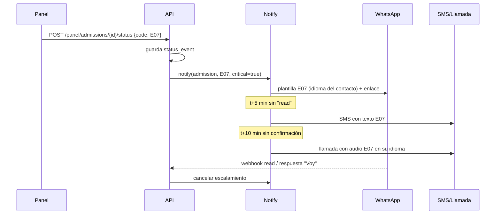

# Design: Sala Tranquila MVP

## Visión general
Un núcleo (backend FastAPI + Postgres) que recibe estados desde el panel del hospital y los distribuye por varios canales a la familia. Un servicio de voz separado (Meta MMS) convierte voz↔texto e identifica idioma. El agente LLM solo puede actuar mediante herramientas que leen datos ya publicados por el hospital.

## Modelo de datos
| Tabla | Campos clave | Notas |
| --- | --- | --- |
| `hospital` | id, nombre, zona_horaria | Un hospital ficticio en la demo |
| `area` | id, hospital_id, nombre (Urgencias adultos…) | |
| `staff_user` | id, hospital_id, nombre, rol (`triage`, `enfermeria`, `trabajo_social`, `informes`, `admin`), areas[] | Auth con email + contraseña (MVP) |
| `admission` | id, folio (U-0231), token (uuid4), link_code (6 dígitos, hash), area_id, iniciales?, idioma_familia, estado_actual, etapa, proximo_informe_at, abierto, created_at, closed_at, close_reason | Sin nombre completo ni datos clínicos |
| `status_event` | id, admission_id, code, staff_id, created_at | Bitácora inmutable |
| `pending_item` | id, admission_id, type (P01–P04), due_at?, resolved_at? | |
| `broadcast` | id, area_id, code (B01/B02), params(json), staff_id, created_at | |
| `family_contact` | id, admission_id, phone_enc, phone_hash, canal_preferido (wa/sms), idioma, rol (titular/invitado), consent_at, revoked_at | Máx. 3 activos por admission |
| `notification` | id, contact_id, source (status/broadcast/call), code, channel, sent_at, delivered_at, read_at, escalation_level | Para escalamiento y tablero |
| `message_log` | id, contact_id, direction, channel, text_redacted, audio_ref?, created_at | Sin contenido clínico |
| `volunteer` | id, nombre, idiomas[], verificado, disponible | |
| `volunteer_session` | id, contact_id, volunteer_id, started_at, ended_at, rating | |
| `place` | id, tipo, nombre, lat, lng, horario, costo, verificado_at, camas_disponibles?, camas_reportadas_at? | |
| `procedure` | id, slug, titulo, pasos_md, verificado_at | |

## Componentes

### Panel (`web/app/panel`)
- Lista de folios del área con estado actual y contactos vinculados.
- Botones grandes del catálogo; E08 abre selector de pendiente.
- Botón "Aviso general" (B01/B02) y "Llamar familiar".
- "Nuevo folio" → genera tarjeta imprimible (QR = `https://wa.me/<num>?text=FOLIO%20U-0231`).
- Tablero: folios abiertos, llamados pendientes, tiempo llamado→llegada, preguntas resueltas por el agente.

### Vinculación (`linking_service`)
1. Mensaje entrante con `FOLIO U-0231` → pide código de 6 dígitos.
2. Código correcto → envía aviso de privacidad (texto + audio) con botones "Acepto / No acepto".
3. "Acepto" → crea `family_contact`, envía estado actual + enlace web.
4. Rate limit: 5 intentos/número/hora.

### Notificaciones (`notify_service`)

- Escalamiento con tareas programadas (APScheduler o cola simple en Postgres).
- Confirmación: botón "Voy en camino" en WhatsApp o tecla 1 en la llamada.

### Web de seguimiento (`web/app/f/[token]`)
- Server-rendered, sin JS pesado. Barra de 5 etapas, último cambio, próximo informe, pendientes con hora límite.
- Mensaje de "permiso para descansar" cuando no hay pendientes y hay `proximo_informe_at`.
- Botón "Escuchar" que reproduce audio de la página en el idioma del contacto.
- Accesos: Trámites, Lugares cercanos, Hablar con una persona.

### Agente (`agent/`)
- Entrada: texto (o transcripción de voz) + contexto del contacto (admission_id, idioma).
- Herramientas:
  - `consultar_estado(admission_id) -> {code, texto_validado, etapa, ultimo_cambio, proximo_informe}`
  - `estado_pendientes(admission_id) -> [ {tipo, due_at} ]`
  - `guia_tramite(slug) -> {titulo, pasos, verificado_at}`
  - `buscar_lugares(tipo, lat?, lng?) -> top 3`
  - `pedir_voluntario(contact_id, motivo) -> {asignado, eta}`
- `guardrails.py`: clasificador previo (reglas + LLM) que detecta temas clínicos y fuera de tema; responde con plantilla.
- Prompt de sistema en `prompts/system_es.md`: rol, límites, tono (frases cortas, usted, sin tecnicismos), nunca inventar.
- Respuestas en idioma no español: usar plantillas validadas; si no hay, ofrecer voluntario.

### Servicio de voz (`speech/server.py`)
- `POST /lid` audio → {iso, score}
- `POST /asr` audio + iso → {texto, score}
- `POST /tts` texto + iso → audio ogg/opus (formato de nota de voz de WhatsApp)
- Umbral de confianza configurable; debajo → fallback a botones o voluntario.

### Lugares y trámites
- `places_verified.csv` cargado al iniciar; Google Places solo para farmacias/cajeros/comida si no hay verificados.
- Trámites en markdown con front-matter (`titulo`, `verificado_at`).

## Seguridad y privacidad
- Cifrado de columna para teléfonos (Fernet/AES-GCM con `ENCRYPTION_KEY`); búsqueda por `phone_hash` (HMAC).
- JWT corto para el panel; roles por área.
- Enlaces familiares firmados con `LINK_SIGNING_SECRET`, caducan en 24 h.
- `retention_job` diario: borra `family_contact`, `message_log`, `notification` de folios cerrados hace más de 30 días.
- Redacción en `message_log` (no guardar audio crudo más de 24 h).

## Manejo de errores
- Si WhatsApp falla → SMS inmediato para avisos críticos.
- Si el servicio de voz no responde → responder por texto y ofrecer voluntario.
- Si el LLM falla → menú de botones con las 4 opciones principales.

## Estrategia de pruebas
- Unitarias: catálogo, escalamiento (tiempos simulados), permisos, rate limit, guardrails (casos clínicos y fuera de tema).
- Integración: webhook WhatsApp simulado → agente → respuesta.
- E2E (Playwright): guion de demo completo.

## Datos de demo (seed)
- Hospital "Hospital General Ejemplo (IMSS-Bienestar)", área Urgencias adultos.
- Personal: triage, enfermería, trabajo social (contraseñas de demo).
- Folio U-0231, idioma náhuatl, contacto "Rosa".
- 5 lugares verificados (1 albergue con cupo, 1 comedor, 1 farmacia 24 h, 1 cajero, 1 punto de carga).
- 3 trámites.
